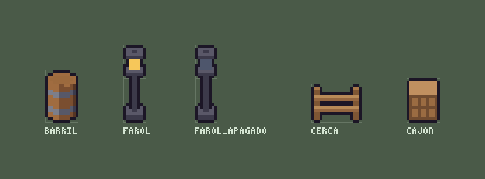

# Props en tres cuartos

Un farol, un barril, una cerca, un cajón: el relleno que pide la densidad de un
mapa, hecho con **receta** en vez de píxel por píxel (Khadosh/pixel-gaming-studio#12).



La receta de un objeto es un **modelo voxel** (`bin/pgs voxel`), el mismo que
arma los muebles del estudio, visto como un juego de vista de arriba dibuja sus
props: `"projection": "front"`.

- Una unidad en x es **un píxel** de ancho; una de alto, un píxel; una de fondo,
  **medio píxel**: el techo de un cajón de 10 de fondo son 5 filas.
- Se ven los techos y el frente (+y). Los costados quedan de canto: se ven al
  girar el modelo (`rotate: 90`), nunca en ochavas.
- Todo lo del voxel sigue andando: cilindros sombreados por su normal (el
  barril redondo, los aros que sonríen), dibujos en una cara (los listones del
  cajón), `base` + `changes` (el farol apagado es el prendido con otro vidrio),
  `frames`, `shadows`, capas.
- El `.txt` que escribe con `txt=` es **un objeto de mapa**: lleva
  `generated_by:`, `anchor:` (el píxel del pie: el `pivot` del modelo, o
  (0, 0, 0)), y el `footprint:` y los `tags:` que dice el modelo. Va directo a la
  carpeta `objetos/` de una receta de mapa y se pide por etiqueta
  (`pick: ["luz"]`); el retoque a mano va en `<objeto>.retoque.txt` y sobrevive
  a volver a correr la receta.

```sh
bin/pgs voxel model=examples/props/farol.json out=/tmp/farol.pss.json txt=examples/props/farol.txt
bin/pgs voxel model=examples/props/farol_apagado.json out=/tmp/farol_apagado.pss.json txt=examples/props/farol_apagado.txt
```

Un modelo que ya existe en 2:1 sale en tres cuartos sin tocarlo: otro modelo
con `"base": "<el de 2:1>"` y `"projection": "front"`.

**Medidas que dan limpio.** Un frente a una profundidad impar cae a medio
píxel (y / 2): sale igual, pero redondeado. Las tablas, aros y techos se leen
mejor con 2 de alto que con 1, y los colores son los del mundo (`palette` o el
`pgs.json`), acá en hex para que el ejemplo no dependa de ninguno.
