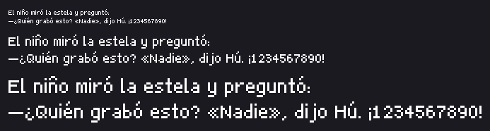

# Tipografía de ejemplo

**Nube 8**, una fuente de pixel art proporcional, con todos los glifos del
castellano. No es un alfabeto de prueba: es la fuente de la que arranca el
próximo juego, y a la vez el mapa de cómo se hace una.



## Los archivos

| archivo | qué es |
|:---|:---|
| `nube_base.txt` | la **hoja de glifos a mano**: 94 glifos en una grilla de celdas de 8x11. Sin `generated_by:`, o sea dibujada |
| `nube.compose.json` | la **receta** de los 16 glifos que faltan: los acentos, la diéresis, la eñe y la puntuación invertida |
| `nube.txt` | la **fuente**: las filas del dibujo base más las compuestas. La escribe `font_compose` y lo dice en `generated_by:` |
| `nube.retoque.txt` | el **retoque a mano** sobre lo generado, en su archivo aparte. Sobrevive a volver a correr la receta |
| `muestra.png` | la frase de control a 1x, 2x y 3x, lo que escribe `font_contact` |

## Una fuente es un dibujo de texto

El mismo formato que todo lo demás en PSS. La hoja es **un solo cuadro** con una
grilla de celdas, un glifo por celda, y cuatro renglones de cabecera que sólo la
tipografía entiende:

```
font: cell=8x11 baseline=9 line=12 space=3 track=1
glyphs: ABCDEFGHIJKLMNOP      un renglón por fila de celdas, un carácter por
glyphs: QRSTUVWXYZ            celda, de izquierda a derecha; un espacio la saltea
advance: 1=5 space=3          el avance, cuando la tinta no es la medida
kern: AV=-1                   pares de kerning, opcional y chico
```

Se dibuja en una hoja y no en cien archivos de un glifo cada uno porque **así se
juzga una fuente**: con el alfabeto entero a la vista. Y porque los píxeles
tienen que vivir en un dibujo de texto para que el editor los abra y ande la
maquinaria del retoque (`/dibujo` en la app).

**El dibujo es la métrica.** El avance de un glifo es su última columna pintada
más uno, más `track`: dibujás una letra más ancha y ocupa más lugar, sin tabla
que mantener al día. El margen izquierdo es el que tenga la celda, o sea que se
dibuja en vez de declararse. `advance:` es para los pocos donde la tinta no es
la medida: el espacio, que no tiene tinta, y el `1`, que se declara igual al
resto de los dígitos para que una columna de números quede alineada.

Se diseña a **un** tamaño y se escala por enteros. No hay hinting, ni suavizado,
ni una variante por cuerpo: eso es pensar en vectorial, y es justo lo que hace
que una fuente de pixel art se vea mal en un juego.

### Las filas de la celda

```
fila 0      ← acentos de las mayúsculas
fila 1-2    ← acentos de las minúsculas (y el palo de b d f h k l t llega a la 2)
fila 3-8    ← mayúsculas y dígitos (6 filas)
fila 4-8    ← minúsculas (altura de x: 5 filas)
base 9      ← la línea de base: las filas 0 a 8 están arriba
fila 9-10   ← las colas de g j p q y
línea 12    ← de una base a la siguiente
```

## La receta y la mano

Los acentos no se dibujan veinte veces: se derivan. `nube.compose.json` dice
«`á` es `a` con la marca `´` arrancando en la fila 1», «`¿` es `?` dado vuelta y
bajado una fila». Centrar la marca sobre la tinta de la letra es el
comportamiento por omisión; `dx` la corre.

```bash
bin/pss font_compose spec=examples/tipografia/nube.compose.json out=examples/tipografia/nube.txt
```

Eso escribe `nube.txt` con `generated_by: font_compose spec=… base=…`, y **no
pisa** un dibujo hecho a mano ni uno de otra receta: corta nombrando el archivo
(`force=true` para pisarlo igual).

El retoque va aparte, en `nube.retoque.txt`, y `font`/`font_contact` lo ponen
encima solos. Acá hay uno solo y chiquito, a propósito: antes de aceptar un
retoque la pregunta es **si no debería ser un parámetro**, y casi siempre lo es
(todas las cuestiones de dónde cae la marca las contestó `dx`). Lo que quedó
para la mano es el acento de la `Í`: `dx` mueve la marca, no la ensancha, y dos
píxeles sueltos a un costado de una `I` se leen como un error de tipeo. El
tercer píxel es la mano.

La capa dice **tres** cosas, no dos: `.` deja pasar lo que pintó la receta, un
glifo de la leyenda pinta ese color, y **`!` saca el píxel** (lo deja
transparente). O sea que lo que ves en el editor es lo que queda: borrar algo que
dibujó la receta no se pierde al guardar, y volver a correr `font_compose` no lo
devuelve, porque el borrado vive en el retoque y la receta sólo escribe la base.
El `!` no puede ser un color (una línea de leyenda que lo intente es un error) y
sólo se acepta en un dibujo con `retouch_of:`, que es el único lugar donde «sacar
el de abajo» significa algo.

> **El semáforo.** Cuanto más tapa la capa, menos cierto es que la receta genera
> este dibujo. `font`, `font_contact` y `font_compose` contestan siempre cuánto
> tapa —`retoque · nube.retoque.txt: 1 px pintados · <1% del dibujo lo decide la
> capa`— y a partir del **20%** avisan que las correcciones convienen arriba, en
> la receta. Es un aviso: nunca impide guardar ni generar. Acá estamos en 1
> píxel de ~1159, que es el orden en el que un retoque es lo que debe ser.

## Mirarla sin ojos

Es la parte que importa cuando el que genera es un agente. `font_contact` compone
una frase y devuelve la imagen **y** lo que hay que mirar:

```bash
bin/pss font_contact path=examples/tipografia/nube.txt out=/tmp/muestra.png
```

```
nube · celda 8x11 · 111 glifos · base 9 · línea 12 · espacio 3 · track 1
frase: «El niño miró la estela y preguntó: ⏎ —¿Quién grabó esto? …» a 1x, 2x, 3x
  ancho 223 px · caja 23 px · tinta en las filas 1..10 de 11
  faltan: ninguno
  se tocan: ninguno
✓ sin problemas
```

- **faltan** — caracteres de la frase que la fuente no tiene. Es el error que en
  un juego aparece como un cuadradito en medio de un diálogo.
- **se tocan** — pares de letras que en la frase quedan pegadas sin un píxel en
  el medio. Se mide sobre la frase compuesta, no sobre las celdas: es el único
  control que ve la fuente como texto.
- **tinta en las filas** — qué parte de la celda usa de verdad. Si la frase no
  llega a la fila 10, la caja está más alta de lo que hace falta.
- También avisa de celdas con tinta que ningún renglón `glyphs:` reclama, de
  glifos que llenan la celda a lo ancho (sólo `track` los separa del de al lado)
  y de los que cruzan la línea de base.

Sin frase usa una que recorre todo el castellano. Con `scale=[6]` y una frase
corta se mira un glifo de cerca; `table=true` lista celda, caja de tinta y
avance de cada uno.

## Llevarla a Godot

```bash
bin/pss font path=examples/tipografia/nube.txt out=/tmp/nube.fnt godot_import=true
```

Escribe tres archivos: `nube.fnt` (AngelCode BMFont), `nube.png` (la hoja, 1:1)
y `nube.fnt.import`. Se copian los tres a la carpeta del juego y Godot 4 la
importa como `FontFile`. El `.import` trae lo único que importa de verdad en una
fuente de pixel art: `scaling_mode=1`, **sólo enteros**, para que el motor la
dibuje a 1x, 2x y 3x y nunca a 1,45x.

En código, sin importador de por medio:

```gdscript
var f := FontFile.new()
f.load_bitmap_font("res://nube.fnt")
f.fixed_size_scale_mode = TextServer.FIXED_SIZE_SCALE_INTEGER_ONLY
$Label.add_theme_font_override("font", f)
$Label.add_theme_font_size_override("font_size", 22)   # 2x de 11
```

La hoja está dibujada en blanco a propósito: así el motor la tiñe con
`font_color`. Con `ink=#rrggbb` se exporta de otro color.

**Está verificado contra el motor, no deducido:** se cargó la fuente exportada en
Godot 4.6 headless, se le pidió la frase de arriba glifo por glifo al `TextServer`
y se armó la imagen con los bitmaps que devuelve. Los 751 píxeles de tinta
coinciden **uno a uno** con los que dibuja `font_contact` a 1x.

## Hacer otra

1. Copiá `nube_base.txt`, cambiá `id:` y borrá los cuadros (dejá la grilla).
2. Dibujá en el editor (`/dibujo`) o en cualquier editor de texto: un glifo por
   celda. Los renglones `glyphs:` dicen qué carácter es cada una.
3. `font_contact` después de cada tanda. La frase de control tarda un segundo y
   caza lo que el ojo perdona a 1x.
4. Cuando las letras base estén, `font_compose` para los acentos.
