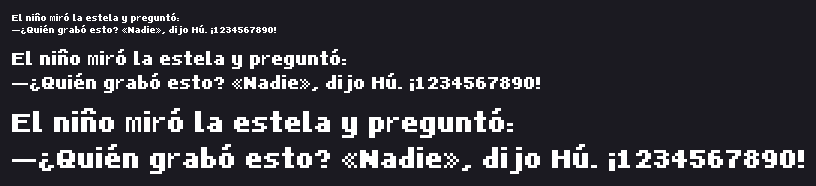
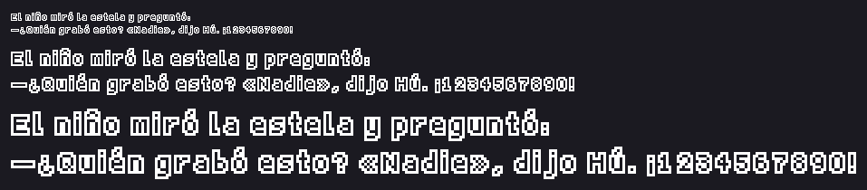
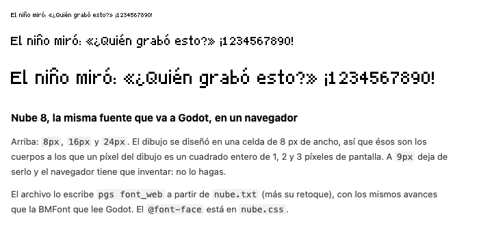

# Tipografía de ejemplo

**Nube 8**, una fuente de pixel art proporcional, con todos los glifos del
castellano. No es un alfabeto de prueba: es la fuente de la que arranca el
próximo juego, y a la vez el mapa de cómo se hace una.


## Los archivos

| archivo | qué es |
|:---|:---|
| `nube_base.txt` | la **hoja de glifos a mano**: 94 glifos en una grilla de celdas de 8x11. Sin `generated_by:`, o sea dibujada |
| `nube.compose.json` | la **receta** de los 16 glifos que faltan: los acentos, la diéresis, la eñe y la puntuación invertida |
| `nube.txt` | la **fuente**: las filas del dibujo base más las compuestas. La escribe `font_compose` y lo dice en `generated_by:` |
| `nube.retoque.txt` | el **retoque a mano** sobre lo generado, en su archivo aparte. Sobrevive a volver a correr la receta |
| `muestra.png` | la frase de control a 1x, 2x y 3x, lo que escribe `font_contact` |
| `nube.ttf` | la **fuente para la web**: el mismo dibujo como TrueType, lo que escribe `font_web` |
| `nube.css` | el `@font-face` que la carga, con la regla que la hace comportarse |
| `web.html` | la página que la usa, y el control: Chrome contra el renderizador de PGS |
| `muestra-web.png` | la captura de esa página en Chrome, para mirarla |
| `nube.contorno.txt` · `nube.sombra.txt` · `nube.negrita.txt` | las **tres variantes derivadas** del mismo dibujo, lo que escribe `font_variant` |
| `nube.negrita.retoque.txt` | el retoque de la negrita: los catorce glifos que el emborronado cerró |
| `muestra-contorno.png` · `muestra-sombra.png` · `muestra-negrita.png` | la frase de control de cada variante a 1x, 2x y 3x |

## Una fuente es un dibujo de texto

El mismo formato que todo lo demás en PGS. La hoja es **un solo cuadro** con una
grilla de celdas, un glifo por celda, y cuatro renglones de cabecera que sólo la
tipografía entiende:

```
font: cell=8x11 baseline=9 line=12 space=3 track=1
glyphs: ABCDEFGHIJKLMNOP      un renglón por fila de celdas, un carácter por
glyphs: QRSTUVWXYZ            celda, de izquierda a derecha; un espacio la saltea
advance: 1=5 space=3          el avance, cuando la tinta no es la medida
kern: AV=-1                   pares de kerning, opcional y chico
```

Se dibuja en una hoja y no en cien archivos de un glifo cada uno porque **así se
juzga una fuente**: con el alfabeto entero a la vista. Y porque los píxeles
tienen que vivir en un dibujo de texto para que el editor los abra y ande la
maquinaria del retoque (`/dibujo` en la app).

**El dibujo es la métrica.** El avance de un glifo es su última columna pintada
más uno, más `track`: dibujás una letra más ancha y ocupa más lugar, sin tabla
que mantener al día. El margen izquierdo es el que tenga la celda, o sea que se
dibuja en vez de declararse. `advance:` es para los pocos donde la tinta no es
la medida: el espacio, que no tiene tinta, y el `1`, que se declara igual al
resto de los dígitos para que una columna de números quede alineada.

Se diseña a **un** tamaño y se escala por enteros. No hay hinting, ni suavizado,
ni una variante por cuerpo: eso es pensar en vectorial, y es justo lo que hace
que una fuente de pixel art se vea mal en un juego.

### Las filas de la celda

```
fila 0      ← acentos de las mayúsculas
fila 1-2    ← acentos de las minúsculas (y el palo de b d f h k l t llega a la 2)
fila 3-8    ← mayúsculas y dígitos (6 filas)
fila 4-8    ← minúsculas (altura de x: 5 filas)
base 9      ← la línea de base: las filas 0 a 8 están arriba
fila 9-10   ← las colas de g j p q y
línea 12    ← de una base a la siguiente
```

## La receta y la mano

Los acentos no se dibujan veinte veces: se derivan. `nube.compose.json` dice
«`á` es `a` con la marca `´` arrancando en la fila 1», «`¿` es `?` dado vuelta y
bajado una fila». Centrar la marca sobre la tinta de la letra es el
comportamiento por omisión; `dx` la corre.

```bash
bin/pgs font_compose spec=examples/tipografia/nube.compose.json out=examples/tipografia/nube.txt
```

Eso escribe `nube.txt` con `generated_by: font_compose spec=… base=…`, y **no
pisa** un dibujo hecho a mano ni uno de otra receta: corta nombrando el archivo
(`force=true` para pisarlo igual).

El retoque va aparte, en `nube.retoque.txt`, y `font`/`font_contact` lo ponen
encima solos. Acá hay uno solo y chiquito, a propósito: antes de aceptar un
retoque la pregunta es **si no debería ser un parámetro**, y casi siempre lo es
(todas las cuestiones de dónde cae la marca las contestó `dx`). Lo que quedó
para la mano es el acento de la `Í`: `dx` mueve la marca, no la ensancha, y dos
píxeles sueltos a un costado de una `I` se leen como un error de tipeo. El
tercer píxel es la mano.

La capa dice **tres** cosas, no dos: `.` deja pasar lo que pintó la receta, un
glifo de la leyenda pinta ese color, y **`!` saca el píxel** (lo deja
transparente). O sea que lo que ves en el editor es lo que queda: borrar algo que
dibujó la receta no se pierde al guardar, y volver a correr `font_compose` no lo
devuelve, porque el borrado vive en el retoque y la receta sólo escribe la base.
El `!` no puede ser un color (una línea de leyenda que lo intente es un error) y
sólo se acepta en un dibujo con `retouch_of:`, que es el único lugar donde «sacar
el de abajo» significa algo.

> **El semáforo.** Cuanto más tapa la capa, menos cierto es que la receta genera
> este dibujo. `font`, `font_contact` y `font_compose` contestan siempre cuánto
> tapa —`retoque · nube.retoque.txt: 1 px pintados · <1% del dibujo lo decide la
> capa`— y a partir del **20%** avisan que las correcciones convienen arriba, en
> la receta. Es un aviso: nunca impide guardar ni generar. Acá estamos en 1
> píxel de ~1159, que es el orden en el que un retoque es lo que debe ser.

## Mirarla sin ojos

Es la parte que importa cuando el que genera es un agente. `font_contact` compone
una frase y devuelve la imagen **y** lo que hay que mirar:

```bash
bin/pgs font_contact path=examples/tipografia/nube.txt out=/tmp/muestra.png
```

```
nube · celda 8x11 · 111 glifos · base 9 · línea 12 · espacio 3 · track 1
frase: «El niño miró la estela y preguntó: ⏎ —¿Quién grabó esto? …» a 1x, 2x, 3x
  ancho 223 px · caja 23 px · tinta en las filas 1..10 de 11
  faltan: ninguno
  se tocan: ninguno
✓ sin problemas
```

- **faltan** — caracteres de la frase que la fuente no tiene. Es el error que en
  un juego aparece como un cuadradito en medio de un diálogo.
- **se tocan** — pares de letras que en la frase quedan pegadas sin un píxel en
  el medio. Se mide sobre la frase compuesta, no sobre las celdas: es el único
  control que ve la fuente como texto.
- **tinta en las filas** — qué parte de la celda usa de verdad. Si la frase no
  llega a la fila 10, la caja está más alta de lo que hace falta.
- También avisa de celdas con tinta que ningún renglón `glyphs:` reclama, de
  glifos que llenan la celda a lo ancho (sólo `track` los separa del de al lado)
  y de los que cruzan la línea de base.

Sin frase usa una que recorre todo el castellano. Con `scale=[6]` y una frase
corta se mira un glifo de cerca; `table=true` lista celda, caja de tinta y
avance de cada uno.

## Las variantes: contorno, sombra y negrita

Los **tamaños** ya son gratis: los cuerpos son múltiplos enteros de la celda, así
que 16 y 24 son el mismo dibujo escalado exacto. Las **variantes** también se
derivan, y con la misma máquina: si `font_compose` saca la `á` estampando una
marca sobre la `a`, una variante es un paso más de lo mismo sobre la hoja
entera.

```bash
bin/pgs font_variant path=examples/tipografia/nube.txt \
                     out=examples/tipografia/nube.negrita.txt kind=bold
```

| variante | método | celda | avance | qué cerró |
|:---|:---|:---|:---|:---|
| **contorno** (`kind=outline`) | dilatar y restar: la letra queda hueca | 8x11 → **10x13** | +2 px | `#` |
| **sombra** (`kind=shadow`) | una copia corrida 1,1 por debajo, en otro color | 8x11 → **9x12** | +1 px | `#`, y lo toma la sombra |
| **negrita** (`kind=bold`) | emborronado: la tinta unida consigo misma corrida 1 px | 8x11 → **9x11** | +1 px | **14 glifos** |



Mismo contrato que `font_compose`, y eso es lo que lo hace servible: el dibujo
derivado lleva `generated_by: font_variant`, **se niega a pisar** un dibujo
hecho a mano o de otra receta (`force=true` para hacerlo igual), y el retoque
vive al lado en `<hoja>.retoque.txt` y sobrevive a volver a generar. El semáforo
de divergencia contesta siempre cuánto tapa la capa.

### El avance se recalcula solo, y por eso nadie pega dos letras

El avance de un glifo es su última columna pintada más uno, más `track`. Una
letra más gorda ocupa más **y la métrica la sigue sin que nadie mantenga una
tabla**: la `a` pasa de avance 5 a 6 en la negrita y a 7 en el contorno, sin una
línea de configuración. El `1`, que está declarado para alinearse con los otros
dígitos, crece lo mismo que ellos; el espacio, que no tiene tinta, no crece.

Lo mejor de eso es gratis y no es obvio: **el hueco entre dos letras se
conserva**. Lo que la operación agrega a la derecha se lo lleva el avance, y el
margen izquierdo está dibujado, no declarado, así que el hueco sale igual que
antes. Un contorno que pega dos letras es peor que no tener contorno, y por eso
las tres pasan `font_contact` con `se tocan: ninguno`.

La celda crece para que nada se recorte, y `baseline` y `line` crecen con ella,
de modo que el interlineado de la variante es el de la original. La letra se
queda donde estaba respecto de la línea de base: lo que la operación agrega —el
anillo, la sombra— cae un píxel por debajo, que es exactamente lo que una sombra
hace.

### La negrita necesita manos, y el comando dice cuáles

En Nube 8 el problema no son los cuencos de 2 px —ésos aguantan y quedan en
1—, son los **trazos a 1 px uno de otro**. La `m` es `@.@.@`: emborronarla la
deja en un bloque macizo, y `miró` se compone `■iró`. Catorce glifos:

```
se cerraron: W m r w x 4 " « » ¨ * & # …
se angostaron: A B C D G H K M N O P Q R U V X Y a b d e g h k n o p q u v y 0 2 3 5 6 8 9 ~ á é ó ñ Á Ó Ñ
quedaron en 1 px de contraforma: B K Q a e k x 3 8 ~ * % & á é
✗ 14 glifo(s) perdieron la contraforma: a este cuerpo el truco no alcanza y van a mano
  en el retoque de al lado (se regenera sin perderlo)
```

Eso es la mitad de la capacidad: **generar, mirar y decir cuáles se cerraron**
es más útil que un resultado que parece bien y no lo está. La cuenta no es de
agujeros sino de **contraformas**, abiertas o cerradas: los huecos de la `m`, la
abertura de la `c` y los canales de la `E` no encierran nada y son igual de
necesarios. La primera versión contaba sólo lo encerrado y daba la negrita por
buena mientras `miró` salía `■iró`.

El retoque (`nube.negrita.retoque.txt`, 110 píxeles sacados con `!`, **5% del
dibujo**) decide una sola cosa trece veces: a este cuerpo esos trazos no tienen
lugar para engordar, así que vuelven a un peso único. El `4` es la excepción y
le alcanza **un** píxel para recuperar su contraforma y seguir gordo. Con la capa
encima el comando lo dice:

```
retoque · nube.negrita.retoque.txt: 0 px pintados, 110 borrados · 5% del dibujo lo decide la capa
  con el retoque encima siguen cerrados: ninguno
```

### Qué sobrevive a cada salida



Verificado, no deducido: las tres se exportaron con `font_web` y se miraron en
Chrome con el mismo método de más abajo («Verificado en un navegador»).

- **A Godot (`font`)** sobreviven las tres. La página BMFont de la sombra lleva
  los dos colores (1159 px de tinta y 947 de sombra) y el motor la tiñe con
  `font_color`.
- **A la web (`font_web`)** sobreviven el contorno y la negrita, y **la sombra
  no**: un TrueType no tiene colores, así que la sombra se funde con la tinta en
  una sola mancha. Para una sombra en una página se usa la fuente base con
  `text-shadow: 1px 1px 0 #808080` (y 2 y 3 px en los cuerpos 2x y 3x), que en
  esta grilla cae en píxeles enteros igual.
- **El cuerpo de diseño cambia con la celda**, porque el em es el ancho de la
  celda: la base se compone a 8, 16 y 24 px; la sombra y la negrita a **9, 18 y
  27**; el contorno a **10, 20 y 30**. Mezcladas en una página las tres son
  nítidas, cada una en sus múltiplos.

Lo que una variante **no** resuelve: hereda el carácter de la original. Una
familia de verdad —otra celda, otra voz— se dibuja.

## Llevarla a Godot

```bash
bin/pgs font path=examples/tipografia/nube.txt out=/tmp/nube.fnt godot_import=true
```

Escribe tres archivos: `nube.fnt` (AngelCode BMFont), `nube.png` (la hoja, 1:1)
y `nube.fnt.import`. Se copian los tres a la carpeta del juego y Godot 4 la
importa como `FontFile`. El `.import` trae lo único que importa de verdad en una
fuente de pixel art: `scaling_mode=1`, **sólo enteros**, para que el motor la
dibuje a 1x, 2x y 3x y nunca a 1,45x.

En código, sin importador de por medio:

```gdscript
var f := FontFile.new()
f.load_bitmap_font("res://nube.fnt")
f.fixed_size_scale_mode = TextServer.FIXED_SIZE_SCALE_INTEGER_ONLY
$Label.add_theme_font_override("font", f)
$Label.add_theme_font_size_override("font_size", 22)   # 2x de 11
```

La hoja está dibujada en blanco a propósito: así el motor la tiñe con
`font_color`. Con `ink=#rrggbb` se exporta de otro color.

**Está verificado contra el motor, no deducido:** se cargó la fuente exportada en
Godot 4.6 headless, se le pidió la frase de arriba glifo por glifo al `TextServer`
y se armó la imagen con los bitmaps que devuelve. Los 751 píxeles de tinta
coinciden **uno a uno** con los que dibuja `font_contact` a 1x.

## Llevarla a una página

La BMFont no le sirve a un navegador. El mismo dibujo sale también como
TrueType, que es lo que un `@font-face` carga:

```bash
bin/pgs font_web path=examples/tipografia/nube.txt \
                 out=examples/tipografia/nube.ttf \
                 css=examples/tipografia/nube.css
```

Escribe dos archivos: `nube.ttf` (la fuente) y `nube.css` (el `@font-face` y la
regla que la usa, nombrando al `.ttf` como vecino). Se copian los dos a un sitio
y la página tiene la fuente:



```html
<link rel="stylesheet" href="nube.css">
<p class="nube-8">El niño miró la estela.</p>
<p class="nube-8 nube-8-2x">Y no dijo nada.</p>
```

**El cuerpo es múltiplo de 8.** La celda mide 8 de ancho —de ahí el 8 del
nombre— y ése es el cuadratín de la fuente: a `font-size: 8px` un píxel del
dibujo es un píxel de pantalla, a 16 es un cuadrado de 2 y a 24 uno de 3. A 9 px
deja de ser un cuadrado entero y el navegador tiene que inventar. `em=` mueve el
cuerpo de diseño si una fuente se dibujó pensando en otro número.

Lo nítido sale de la geometría, no de una propiedad de CSS: cada píxel pintado es
un cuadrado exacto apoyado en la grilla, así que a esos cuerpos cada borde cae en
un píxel entero de pantalla y la cobertura de cada píxel es 0 o 1. El
`-webkit-font-smoothing: none` del CSS es un cinturón, no los tiradores.

La otra mitad es el **alto de la caja**: el ascenso es la base (9) y el descenso
es lo que la línea deja (3), de modo que la caja de contenido mide exactamente la
línea del dibujo (12) y el medio-interlineado de `line-height: 12px` es cero. Si
el descenso fuera sólo la tinta (2), la caja mediría 11, el medio-interlineado
sería medio píxel y **todo el renglón se dibujaría corrido**: un píxel abajo a
16 px, dos a 24. Eso pasó, y lo encontró el control de acá abajo.

### Verificado en un navegador, no deducido

`web.html` es la página de ejemplo **y** el control. Escribe la misma frase a 8,
16 y 24 px y declara en `data-scale` y en `--x`/`--y` dónde arranca cada renglón,
así que se puede recortar una captura y compararla contra lo que dibuja el
renderizador propio de PGS (`renderText`, el mismo que hace `muestra.png`):

```bash
python3 -m http.server 8771 &                     # un navegador no carga una fuente por file://
"/Applications/Google Chrome.app/Contents/MacOS/Google Chrome" \
  --headless --disable-gpu --hide-scrollbars --force-device-scale-factor=1 \
  --default-background-color=FFFFFFFF --window-size=700,350 \
  --screenshot=examples/tipografia/muestra-web.png \
  http://127.0.0.1:8771/examples/tipografia/web.html
```

Lo que dio, sobre la frase «El niño miró: «¿Quién grabó esto?» ¡1234567890!»:

```
escala 1 (cuerpo 8px)  · caja 206x11 · tinta PGS 426  · tinta Chrome 426  · difieren 0
escala 2 (cuerpo 16px) · caja 412x22 · tinta PGS 1704 · tinta Chrome 1704 · difieren 0
escala 3 (cuerpo 24px) · caja 618x33 · tinta PGS 3834 · tinta Chrome 3834 · difieren 0
✓ sin suavizado: todos los píxeles son blanco puro o negro puro
✓ igualdad píxel a píxel en las tres escalas
```

Igualdad **píxel a píxel**, no «se ve bien»: los 5964 píxeles de tinta de los tres
renglones caen donde el dibujo dice, y ninguno de los 31 724 píxeles de las tres
cajas tiene un valor intermedio, o sea cero suavizado. Con el descenso puesto en
la tinta, el mismo control marcaba 2605 píxeles distintos. El test que lo deja
cazado es `the content box is the line of the drawing` en
`src/headless/fontweb.test.ts`.

## Hacer otra

1. Copiá `nube_base.txt`, cambiá `id:` y borrá los cuadros (dejá la grilla).
2. Dibujá en el editor (`/dibujo`) o en cualquier editor de texto: un glifo por
   celda. Los renglones `glyphs:` dicen qué carácter es cada una.
3. `font_contact` después de cada tanda. La frase de control tarda un segundo y
   caza lo que el ojo perdona a 1x.
4. Cuando las letras base estén, `font_compose` para los acentos.
